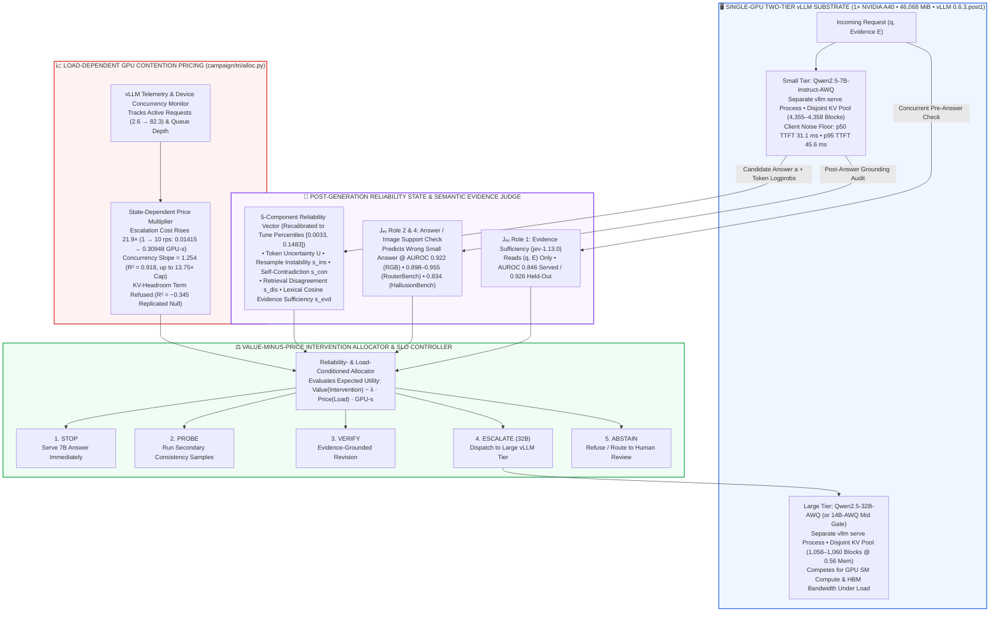

<div align="center">

# ⚡ TRIAGE: Reliability- and Load-Conditioned Escalation for Two-Tier LLM Serving with a Semantic Evidence Judge

### *Post-Generation Reliability State, Load-Dependent GPU Pricing & Pre-Registered Systems Evaluation on vLLM*

**Basavaraj R M, Aryan Bharat Kumar** 

**Two-Tier vLLM Serving (`Qwen2.5-7B-AWQ` → `32B-AWQ` on NVIDIA A40) • Proposition 1 (`AUROC = 0.500` Prompt-Only Bound) • Semantic Evidence Judge (`Jₑᵥ`: `0.846` Served / `0.926` Held-Out) • `21.9×` Marginal Load Price (`1 → 10 rps`) • Doubly Robust Off-Policy Evaluation (`RouterBench` & `HallusionBench`)**

[](https://arxiv.org/abs/2611.01174)
[-2563EB?style=for-the-badge&logo=nvidia&logoColor=white)](#2-systems-layer-load-dependent-gpu-pricing-kv-cache-headroom-null--slo-control)
[-AUROC%200.846%20SERVED%20%7C%200.926%20HELD--OUT-7C3AED?style=for-the-badge&logo=pytorch&logoColor=white)](#1-theoretical-identification--the-semantic-evidence-judge-proposition-1--jₑᵥ)

[-DC2626?style=for-the-badge)](#2-systems-layer-load-dependent-gpu-pricing-kv-cache-headroom-null--slo-control)
[-79.5%25%20COST%20SAVED%20%40%20AUROC%200.898-059669?style=for-the-badge)](#3-cross-pair-generalization--doubly-robust-off-policy-evaluation-routerbench--hallusionbench)
[-AUROC%200.834%20(0.944%20TABLES)-0D9488?style=for-the-badge)](#32-multimodal-verification-on-hallusionbench-n--743-images-356-pairs)
[](#4-pre-registered-campaign-audit-the-66-item-gate-trap--headline-root-cause-analysis)

</div>

---

*Training-free, reliability- and load-conditioned inference allocator for two-tier LLM serving.*
<br>
<br>
[](https://triage-o6q3.onrender.com/)
<br>

> **📌 Project Status Note:** This repository contains the complete two-layer **TRIAGE** research and systems artifact: the **GPU Systems Campaign (`campaign/`)** built on **vLLM** (`Qwen2.5-7B-Instruct-AWQ`, `14B-AWQ`, and `32B-AWQ` on an NVIDIA A40) alongside the **Interactive Serving Application & API-Era Artifacts (`triage/`)**. All pre-registered hypotheses (`C1–C4`), falsified predictions, replicated nulls, post-hoc `Jₑᵥ` semantic judge evaluations, and cached per-query receipts (`campaign/runs/` and `triage/data/`) are preserved with zero selective reporting.

A small model answers first. A reliability state (token-level uncertainty, self-consistency, evidence checks) and a load-dependent price of GPU time decide whether to **stop**, **probe**, **verify**, **escalate to a large model**, or **abstain**.

```text
triage/     the serving app: signals, abstention, router (API era)
campaign/   the GPU campaign: vLLM substrate, allocator, controllers, evaluation
```

`campaign/` imports three modules from `triage/` (`signals`, `abstain`, `calculator`), so keep the two side by side.

---

## ⚡ Executive MLSys Scorecard: Pre-Registered Claims, Falsifications & Post-Hoc Discoveries

| Systems / Scientific Pillar | Experimental Protocol & Hardware Substrate | Primary Quantitative Measurement | Core MLSys Verdict & Provenance |
| :--- | :--- | :--- | :--- |
| **1. Evidence-Corruption Identification (`Proposition 1`)** | Paired clean/corrupted copies sharing question `q` byte-for-byte (`40/40` synthetic, `400/400` RGB, `356` HallusionBench pairs) | **Prompt-only `AUROC = 0.500` exactly** (max byte diff `= 0` across all pairs) | **Provable impossibility:** Any router conditioning solely on the prompt `s(q)` is mathematically restricted to chance (`1/2`) when failure stems from corrupted evidence. |
| **2. Pre-Registered Claim `C1` (Falsified) → `Jₑᵥ` Semantic Repair (Post Hoc)** | RGB corruption detection (`600` served A40 rows + `100` never-served held-out items `200–299`, cluster bootstrap `B = 2,000`) | Lexical state: **`0.571`** *(Falsified `< 0.70`)*<br>`Jₑᵥ` Served: **`0.846 [0.810, 0.881]`**<br>`Jₑᵥ` Held-Out: **`0.926 [0.884, 0.962]`** | Fluent, on-topic negative passages leave token uncertainty (`0.504`), instability (`0.500`), and contradiction (`0.500`) at chance; semantic sufficiency (`jev-1.13.0`) resolves detection and predicts wrong answers at **`AUROC = 0.922 [0.891, 0.951]`**. |
| **3. Marginal GPU Price of Escalation vs. Offered Load (`Table 4`)** | 1× NVIDIA A40 (`46,068 MiB`), `vLLM 0.6.3.post1`, forced escalation on every 8th request at `1, 4, 10 rps` (`2` arrival seeds) | **`1 rps`:** `0.01415 GPU-s` (`+23.4 ms` P95)<br>**`4 rps`:** `0.23697 GPU-s` (`+83.5 ms` P95)<br>**`10 rps`:** `0.30948 GPU-s` (`+109.3 ms` P95) | Escalation cost in GPU-seconds rises **`21.9×`** from `1` to `10 rps` (conservative CI ratio **`≈ 11×`**). Against device concurrency (`2.6 → 82.3`), price rises **`14.9×`** (linear slope **`1.254`**, **`R² = 0.918`**). |
| **4. KV-Cache Headroom Sweep (`S2 Gate` / `S5` Null)** | Fixed load, varying 32B KV pool `1,058 → 2,423` blocks (peak occupancy `0.85 → 0.37`) across `k ∈ {2,000..50,000}` | Non-monotone **`~5%` span** (`0.0354, 0.0337, 0.0355 GPU-s`); fresh-host re-run **`1.4%` spread** across `8×` pool (**`R² = −0.345`**) | **Replicated null:** With disjoint `vllm serve` KV pools, cross-tier interference is driven by **compute and memory-bandwidth contention**, not KV-cache capacity headroom. |
| **5. Cross-Pair Routing & Doubly Robust OPE (`Table 3`)** | `RouterBench` (`n = 1,708` test split, 5 task families) across 3 model pairs + `200`-replication OPE audit | Wrong-answer **`AUROC = 0.898–0.955`** (vs. `0.599–0.681` prompt-only); `GPT-3.5 → GPT-4` saves **`79.5%` cost** within `~3 pp` | Cascade wins require a large tier price ratio (`~17×` for `GPT-3.5 → GPT-4`, `+9.73 pp` at 25% budget); at `2–3×` open-model price ratios, small-tier overhead drops cascade below random at 50% budget. DR estimator cuts IPS RMSE in half (**`0.86–1.26 pp`**). |
| **6. Multimodal Verification (`HallusionBench`)** | `743` images in `356` original/edited pairs (`293/356` edits flip ground-truth answer) | Prompt-only: **`0.500`**<br>`Jₑᵥ` Image Check: **`0.834 [0.802, 0.862]`** | Strongest on **tables (`0.944`)**, **charts (`0.928`)**, **figures (`0.885`)**, and **OCR (`0.884`)**; weakest on **math (`0.699`)** and **visual illusions (`0.719`)**. |
| **7. End-to-End Headline Null & Gate Root-Cause (`Table 1`)** | `2,504`-row headline (`5,033` total A40 rows) on `GPQA`, `MATH-500`, `MMLU-Pro`, `HotpotQA` (`n = 626` held-out test) | `S1` tune gate (`n = 66`): **`+13.6 pp`** gap<br>Held-out test (`n = 626`): **`+2.88 pp [-0.80, +6.55]`** | Because `32B` is barely better than `7B` on held-out data (`-3.76 pp` on `GPQA`), the allocator rightly declines to escalate (both score **`0.3578`** at `4.18` vs. `3.77 GPU-s`). |

---

## 🏛️ Dual-Layer System Architecture: Two-Tier vLLM Serving Substrate & Closed-Loop Allocator



---

## 1. Theoretical Identification & The Semantic Evidence Judge (`Proposition 1` & `Jₑᵥ`)

Most deployed model routers decide from the prompt `q` alone before generation begins. In Retrieval-Augmented Generation (RAG) and multimodal VQA, however, the information that determines whether the small model will fail frequently resides in the **attached evidence `E`** (retrieved passages or visual inputs) rather than the question string `q`.

### 1.1 Proposition 1: Exact Chance Bound for Prompt-Only Routers

Consider a paired evidence-corruption benchmark containing, for each base item, a clean copy `(q, E⁺)` and a corrupted copy `(q, E⁻)` that share the question `q` byte-for-byte and differ only in the attached evidence.

> **Proposition 1 (Prompt-Only Unidentifiability):**
> *If the positive (corrupted) and negative (clean) classes contain the identical multiset of questions `q`, then any routing score `s(q)` that depends on the question alone has **`AUROC = 1/2` (`0.500`)** exactly.*
>
> **Proof:** *Because the multiset of questions is identical across both classes, the positive and negative classes induce the exact same probability distribution on `s(q)`. For independent draws `S⁺` and `S⁻` from a single distribution, symmetry guarantees `Pr(S⁺ > S⁻) = Pr(S⁻ > S⁺)`. Substituting into the Mann–Whitney U formulation of AUROC yields `Pr(S⁺ > S⁻) + ½ Pr(S⁺ = S⁻) = ½`.* ∎

This is a structural identity, not an empirical approximation. Our test harness verifies byte-identical questions (`max |Δ| = 0`) across **`40/40` synthetic pairs**, **`400/400` RGB pairs**, and **`356/356` HallusionBench image pairs**.

### 1.2 Pre-Registered Claim `C1` Falsification & Post-Hoc Semantic Repair (`Table 2` & `Figure 2`)

In our pre-registration (`campaign/docs/PREREGISTRATION.md`), we predicted that TRIAGE's 5-component reliability state would detect corrupted RGB evidence at **`AUROC ≥ 0.70`**. **That prediction was falsified on the A40:** the lexical reliability state scored **`0.509`** at corruption rate `0.5` and **`0.571`** at full corruption (`rate = 1.0`).

* **Why Generation-Internal Signals Fail on Fluent RAG Negatives:** Inspecting the individual signal components reveals that **token uncertainty (`0.504`)**, **resampling instability (`0.500`)**, and **self-contradiction (`0.500`)** sit at exact chance. Because RGB negative passages are fluent, topically matched text, they do not cause the 7B model's token probabilities to wobble, nor do they induce high lexical cosine distance (`0.575`).
* **Post-Hoc Repair via `Jₑᵥ` (`jev-1.13.0`, pinned):** We formulated a post-hoc hypothesis replacing lexical cosine similarity with a structured semantic evidence judge (`Jₑᵥ`, network latency `p50 = 356–418 ms`, `p95 = 447–806 ms`, billed at `≈ $0.00002/call`) operating across four distinct roles:
  1. **Role 1 — Evidence Sufficiency (`sufficient`):** Given `(q, passages)`, does the context contain enough information to answer? Because this role requires no model answer, it can execute **concurrently with small-tier generation**.
  2. **Role 2 — Answer Grounding (`relation`):** Given `(q, passages, answer)`, does the evidence *support*, *contradict*, or *say nothing* about the served answer?
  3. **Role 3 — Cross-Pair Cascade & Prompt Routing (`RouterBench`):** Evaluates pre-generation prompt routing vs. post-generation answer verification across diverse model pairs.
  4. **Role 4 — Multimodal Image Verification (`HallusionBench`):** Given `(image, q, answer)`, verifies whether an edited image still supports the ground-truth answer.

| Corruption Detector / Signal Variant | RGB Rate `0.5` (`AUROC`) | RGB Rate `1.0` (`AUROC`) | 95% Cluster Bootstrap CI (`Rate 1.0`) | Pre-Registration & Audit Status |
| :--- | :---: | :---: | :---: | :--- |
| **Prompt-Only Router (Any function `s(q)`)** | `0.500` | `0.500` | `[0.500, 0.500]` *(Exact)* | Provable theoretical floor (`Proposition 1`, verified on `400/400` pairs) |
| **Token Uncertainty / Instability / Contradiction** | `~0.500` | `0.504 / 0.500 / 0.500` | At chance | Fluent on-topic negatives do not perturb internal generation confidence |
| **Lexical Reliability State (`C1` Pre-Registered)** | `0.509` | `0.571` | Below `0.70` bar | **❌ Falsified** (Logged A40 risk reconstruction matched on `600/600` rows) |
| **Lexical Evidence Cosine Score Alone** | `0.516` | `0.575` | Below `0.70` bar | On-topic negative passages preserve high bag-of-words / embedding cosine |
| **`Jₑᵥ` Semantic "Insufficient" (Served, `n = 600` rows)** | `0.573 [0.551, 0.599]` | **`0.846`** | **`[0.810, 0.881]`** | **✅ Clears `0.70` bar** *(Post-hoc replay on logged A40 rows, 0 GPU-s)* |
| **`Jₑᵥ` Semantic "Insufficient" (Held-Out, `n = 100` items)** | `0.667 [0.620, 0.721]` | **`0.926`** | **`[0.884, 0.962]`** | **✅ Out-of-sample validation** on items `200–299` never served to GPU |
| **Un-Retuned 5-Component Risk with `Jₑᵥ` Swapped In** | `0.537` | `0.695` | Borderline `< 0.70` | Evidence term carries only `0.15` weight while 4 sibling signals sit at `0.50` |
| **`Jₑᵥ` "Not Supported" → Predicting Wrong 7B Answers** | **`0.974`** *(Clean: `0.971`)* | **`0.762`** *(All 600: **`0.922`**)* | **`[0.891, 0.951]`** *(All 600)* | Beats logged risk (**`0.561 [0.460, 0.664]`**) by **`+36.1` AUROC points** |

```text
Figure 2: Detecting Fully Corrupted RGB Evidence (Rate = 1.0, Cluster Bootstrap by Base Item)
─────────────────────────────────────────────────────────────────────────────────────────────
AUROC
1.00 ┤                                                                  ┏━━━━━━━━━━┓ 0.926
0.90 ┤                                               ┏━━━━━━━━━━┓ 0.846 ┃          ┃ [0.884, 0.962]
0.80 ┤                                               ┃          ┃       ┃          ┃
0.70 ┤ ─ ─ ─ ─ ─ ─ ─ ─ ─ ─ ─ ─ ─ ─ ─ ─ ─ ─ ─ ─ ─ ─ ─ ╂─ ─ ─ ─ ─ ╂ ─ ─ ─ ╂ ─ ─ ─ ─ ─╂ ─ (0.70 Pre-Reg Bar)
0.60 ┤                            ┏━━━━━━━━━━┓ 0.571 ┃          ┃       ┃          ┃
0.50 ┤         ┏━━━━━━━━━━┓ 0.500 ┃          ┃       ┃          ┃       ┃          ┃
0.40 ┼─────────┻━━━━━━━━━━┻━━━━━━━┻━━━━━━━━━━┻━━━━━━━┻━━━━━━━━━━┻━━━━━━━┻━━━━━━━━━━┻─────────
               Prompt-Only        Lexical State      Jₑᵥ Served         Jₑᵥ Held-Out
               (Exact 1/2)         (Falsified)       (n=600 rows)      (n=100 unseen)
```

> **⚠️ Methodological Caveat on Closed-Book RGB Generation (`§5.3`):** In the RGB GPU run, the initial small-tier answer prompt contained only the question `q`, while retrieved passages reached the answer generator only if a verification step fired. Consequently, `Qwen2.5-7B` was wrong on `71%` of clean items (`72.8%` overall; accuracy `0.290` → `0.255`). Thus, the `0.846 / 0.926` and `0.922` results establish **corrupted-evidence and unsupported-answer detection**, whereas measuring end-to-end accuracy repair requires re-serving with evidence injected into the Tier-0 prompt.

---

## 2. Systems Layer: Load-Dependent GPU Pricing, KV-Cache Headroom Null & SLO Control

A central systems premise of **TRIAGE** is that the marginal cost of escalating a request to a 32B model on shared hardware is **not constant**: large-model prefill and decode passes compete directly with the small tier for GPU SMs and HBM bandwidth.

### 2.1 Marginal GPU-Second Price of Escalation vs. Offered Load (`Table 4` & `Figure 3`)

On a single **NVIDIA A40 (`46,068 MiB`)** running `Qwen2.5-7B-Instruct-AWQ` (`4,355–4,358` KV blocks) and `Qwen2.5-32B-AWQ` (`1,058–1,060` KV blocks at memory fraction `0.56`), we forced an escalation on every 8th request across three offered arrival rates (`2` arrival seeds per rate) and measured the marginal GPU-seconds consumed and the induced tail-latency shift on the small tier:

| Offered Arrival Load (`rps`) | Marginal Escalation Price (`GPU-s`) | 95% Confidence Interval (`GPU-s`)* | Small-Tier `P95` Latency Shift (`Δ ms`) | Relative Price Multiplier vs. `1 rps` |
| :---: | :---: | :---: | :---: | :---: |
| **`1 rps`** *(Near-Idle)* | **`0.01415`** | `[0.0006, 0.0277]` | **`+23.4 ms`** | **`1.0×`** *(Baseline)* |
| **`4 rps`** *(Moderate Load)* | **`0.23697`** | `[0.2090, 0.2650]` | **`+83.5 ms`** | **`16.7×`** |
| **`10 rps`** *(Peak Contention)* | **`0.30948`** | `[0.2962, 0.3228]` | **`+109.3 ms`** | **`21.9×`** *(Conservative CI ratio: **`≈ 11×`**)* |

*\*Note: Confidence intervals come from two arrival seeds; cross-host replication shows between-run variance is `≈ 1.8×` wider than within-run CI half-widths, so CIs are treated as lower bounds on uncertainty.*

```text
Figure 3: Marginal GPU-Second Price of an Escalation vs. Offered Load on 1× NVIDIA A40
──────────────────────────────────────────────────────────────────────────────────────
Price (GPU-s)
0.35 ┤                                                                    ┬  0.30948 GPU-s
0.30 ┤                                                                    ●  (+109.3 ms P95 Δ)
0.25 ┤                             ┬  0.23697 GPU-s            ───────────┴
0.20 ┤                             ●  (+83.5 ms P95 Δ) ────────╯
0.15 ┤                        ╱────┴
0.10 ┤                   ╱───╯
0.05 ┤              ╱───╯
0.01 ┤         ┬───●  0.01415 GPU-s (+23.4 ms P95 Δ)
0.00 ┼─────────┴───────────────────┬──────────────────────────────────────┬───────────
             1 rps               4 rps                                 10 rps
                                  Offered Load (requests / s) →
```

### 2.2 KV-Cache Headroom Sweep (`S2 Gate` / `S5`): A Replicated Systems Null

We tested whether shrinking or expanding the 32B model's KV-cache block pool (`1,058 → 2,423` blocks, shifting peak KV occupancy from `0.85 → 0.37` across `k ∈ {2,000..50,000}` in `campaign/runs/gates23/s2gate/`) alters the marginal escalation price at fixed load:
* **Initial Host Sweep:** Marginal price remained flat and non-monotone across pool sizes (**`0.0354`, `0.0337`, `0.0355 GPU-s`**, total span **`~5%`**).
* **Fresh-Host Replication:** Re-running on a fresh A40 host reversed the sign of the first step and yielded a **`1.4%` spread** across an **`8×` KV pool range**. Fitting a linear headroom term yielded **`R² = −0.345`**, so the KV-headroom term was **formally refused** (`campaign/runs/price_fit.json`).
* **Architectural Explanation:** Because the two tiers run as separate `vllm serve` processes with **disjoint, pre-allocated KV pools**, unused blocks in the 32B pool cannot be borrowed by the 7B tier; cross-tier slowdown is governed by **SM compute and HBM bandwidth contention**, not KV block capacity.

### 2.3 Device Concurrency Contention Fit, Load-Aware Withdrawal & SLO Simulation

* **Device Concurrency Linear Fit (`R² = 0.918`):** Against measured total device concurrency (`2.6 → 82.3` active requests across 4 operating points), marginal escalation price rose **`14.9×`** (`0.00355 → 0.0529 GPU-s`), fitting a linear slope of **`1.254`** (`R² = 0.918`) that extrapolates to a **`13.75×` price multiplier** at peak concurrency.
* **Load-Aware vs. Load-Blind Frontier Trade-Off:** Under the fitted concurrency price and an identical `λ` for both arms:
  * At **idle (`multiplier = 1.0`)**, load-aware and load-blind allocation are **identical to the last decimal**.
  * At **`2, 6, and 12 rps`**, the load-aware allocator withdraws from escalation as the dynamic GPU price spikes, **cutting GPU-seconds by `42.5–85.3%`** and **small-tier `P95` latency by `85.2–96.1%`**, while trading **`6.75–7.75 pp`** quality along the cost-quality frontier.
  * **Non-Monotone Value of Information:** Sweeping the compute price weight `λ` from `0.02 → 0.20` increased total spend by **`19%` (`1.98 → 2.36 GPU-s`)** because intermediate probing information is worth purchasing only when the decision sits near the escalation boundary.
* **Calibrated Discrete-Event SLO Simulator (`P95 ≤ 10 s`, `campaign/runs/slo_sim/`):** Calibrated on **`4,188` measured A40 calls** and evaluated under `2–12 rps` Poisson arrivals and an Azure production conversation trace. A controller that *only* re-prices interventions saturates at its `13×` cap and meets the `P95 ≤ 10 s` SLO on **`2.5–43%`** of runs (vs. **`0%`** for load-blind triage, which escalates `99%` of requests). Because the binding delay under overload is the **small tier's own ingress queue**, holding a hard tail-latency SLO requires pairing dynamic pricing with **admission control or load shedding** (`campaign/tri/control.py`).

---

## 3. Cross-Pair Generalization & Doubly Robust Off-Policy Evaluation (`RouterBench` & `HallusionBench`)

### 3.1 Three Model Pairs on `RouterBench` (`Table 3`, `n = 1,708` Test Split)

To evaluate post-generation semantic routing on pairs with a large, verified quality gap (`20–24 pp`), we benchmarked `Jₑᵥ` across **1,708 held-out test items** (`2,427` total across 5 task families; `GSM8K` excluded due to non-exact quarter-point grading that inverted the signal). Both prompt-only (`Jₑᵥ` reads `q`) and cascade triage (`Jₑᵥ` reads `(q, a_small)`) are charged for their `Jₑᵥ` call (`≈ $0.00002`):

| Model Pair (`Small → Big`) | Tier Quality (`Small / Big`) | Wrong-Answer `AUROC` (`Triage / Prompt`) ↑ | `Δ` vs. Prompt-Only (`50% Budget`, `pp`) | `Δ` vs. Random (`50% Budget`, `pp`) | Escalation Rate (`~1 pp` Point Est.)* | API Cost Reduction vs. `Always-Big` |
| :--- | :---: | :---: | :---: | :---: | :---: | :---: |
| **`Mistral-7B → Mixtral-8x7B`** *(~3× price)* | `0.360 / 0.595` | **`0.955` / `0.599`** | **`+7.67 [+5.8, +9.4]`** | `-2.47 [-4.1, -0.9]` | `44% esc.` | `4.7% lower` |
| **`WizardLM-13B → Yi-34B`** *(~2× price)* | `0.440 / 0.649` | **`0.945` / `0.668`** | **`+2.00 [+0.2, +3.9]`** | `-2.09 [-3.7, -0.5]` | `34% esc.` | `7.1% lower` |
| **`GPT-3.5 → GPT-4`** *(~17× price)* | `0.673 / 0.827` | **`0.898` / `0.681`** | **`+4.49 [+3.4, +5.7]`**<br>*(25% bdg: **`+9.73 [+8.17, +11.57]`**)* | **`+8.31 [+7.2, +9.6]`** | **`20% esc.`** | **`79.5% lower`** |

*\*Note: Paired 95% bootstrap CIs for `quality − always_big` at the operating point are `[-2.52, +1.00]`, `[-2.93, +1.00]`, and `[-2.58, +0.59] pp`, establishing formal TOST non-inferiority at **`≈ 3 pp`**.*

* **Economic Price-Ratio Law:** Post-generation cascades always pay for the small-model pass before deciding whether to escalate. When the strong tier is **`~17×` more expensive** (`GPT-3.5 → GPT-4`), the initial small call is negligible and TRIAGE cuts API spend by **`79.5%`** while beating prompt-only routing by **`+9.73 pp`** at a `25%` budget. When the strong tier is only **`2–3×` more expensive** (open-weight pairs), paying for the small tier on every request consumes too much of a `50%` budget, causing cascade routing to fall **`2.1–2.5 pp` below random pre-generation routing** despite achieving **`0.945–0.955` AUROC**.
* **Off-Policy Evaluation (`OPE`) Validation Against Ground Truth:** Over `200` replications logging a single bandit arm per item under a context-dependent behavior policy:
  * All three estimators (**IPS**, **SNIPS**, and **Doubly Robust `DR`**) are unbiased to within **`0.35 pp`** of full-information ground truth.
  * **Doubly Robust (`DR`)** achieves **`RMSE = 0.86–1.26 pp`**—roughly **half the error of IPS (`1.67–2.60 pp`)**—with empirical 95% CI coverage of **`0.98–1.00`**.

### 3.2 Multimodal Verification on `HallusionBench` (`n = 743` Images, `356` Pairs)

On **HallusionBench**, an original image and human-edited copies share the exact same question string (`Proposition 1` applies; `293 of 356` edits flip the ground-truth answer). While any text-only router is locked at **`AUROC = 0.500`**, `Jₑᵥ`'s multimodal image-support check reaches **`AUROC = 0.834 [0.802, 0.862]`** (cluster bootstrap by pair):

| HallusionBench Visual Subdomain | `Jₑᵥ` Image-Support `AUROC` | Prompt-Only Baseline `AUROC` | Diagnostic Performance Regime |
| :--- | :---: | :---: | :--- |
| **Tables** | **`0.944`** | `0.500` | **🟢 Exceptional** (Structured cell/row verification) |
| **Charts** | **`0.928`** | `0.500` | **🟢 Exceptional** (Quantitative axis/bar reading) |
| **Figures** | **`0.885`** | `0.500` | **🟢 Strong** (Diagrammatic correspondence) |
| **OCR** | **`0.884`** | `0.500` | **🟢 Strong** (Scene-text & glyph verification) |
| **Overall (`743` Images / `356` Pairs)** | **`0.834 [0.802, 0.862]`** | **`0.500`** | **✅ +33.4 AUROC points above prompt-only bound** |
| **Visual Illusions** | `0.719` | `0.500` | 🟡 Moderate (Perceptual trickery) |
| **Math** | `0.699` | `0.500` | 🟡 Weakest subdomain (Symbolic geometric reasoning) |

---

## 4. Pre-Registered Campaign Audit: The 66-Item Gate Trap & Headline Root-Cause Analysis

A defining contribution of this MLSys campaign is its **adversarial scientific audit discipline** (`campaign/docs/PREREGISTRATION.md`, `campaign/docs/NEGATIVES.md`). Before unlocking the held-out test split (tracked via a cryptographic write-once timestamp in `_frozen/first_test_read.json`), the campaign required clearing pre-launch gates (`S1` quality gap gate, `S2` price/headroom gate).

### Table 1: Paired Accuracy Gap (`32B − 7B`) on the Held-Out Test Split (`n = 626`)

| Benchmark Dataset | Paired Accuracy Gap (`32B − 7B`, `pp`) | 95% Bootstrap Confidence Interval (`pp`) | Statistical & Routing Significance |
| :--- | :---: | :---: | :--- |
| **`Pooled Primary Mix (n = 626)`** | **`+2.88 pp`** | **`[-0.80, +6.55]`** | **Includes zero (`S1` 66-item tune gate measured `+13.6 pp`)** |
| **`GPQA-diamond`** | `-3.76 pp` | `[-13.53, +6.02]` | `32B-AWQ` is nominally worse than `7B-AWQ` |
| **`HotpotQA`** | `+2.53 pp` | `[-3.16, +8.23]` | Statistically indistinguishable from zero |
| **`MATH-500` (Levels 4–5)** | `+0.57 pp` | `[-5.68, +6.82]` | Near-zero gap on hard competition math |
| **`MMLU-Pro`** | **`+11.32 pp`** | **`[+3.14, +19.50]`** | **✅ Only sub-benchmark where 32B significantly beats 7B** |

* **Why the 66-Item `S1` Gate Was Fooled:** On the `66`-item tune sample, `Qwen2.5-32B-AWQ` beat `7B-AWQ` by **`+13.6 pp`**, easily clearing the pre-registered `8 pp` gate bar. However, binomial sampling variance on `n = 66` has a 95% half-width of **`≈ ±11 pp`**, meaning a 66-item gate cannot statistically distinguish a true `13 pp` gap from a `3 pp` gap.
* **Downstream Consequence in the `2,504`-Row Headline Stage:** Across the `2,504`-row headline evaluation, both **TRIAGE** and its **load-blind** variant achieved **`0.3578`** accuracy—identical to `always-small`—at **`4.18` vs. `3.77 GPU-s/request`**. Because escalating to `32B` yields almost no accuracy gain (`+2.88 pp`), the value-minus-price allocator **rightly declined to escalate**.
* **Matched-Compute Comparison Against `Qwen2.5-14B-AWQ` (`S2 Gate`):** Against a standalone `14B-AWQ` mid-tier baseline (`0.3861` accuracy at `4.84 GPU-s`), the matched-compute `7B → 32B` cascade scored **`0.3974`**—a paired difference of **`+1.13 pp [-3.20, +5.27]` (`n = 531`)**, reported formally as **`INCONCLUSIVE`** (power analysis indicates resolving a `~1 pp` difference requires `n ≈ 19,600` items).

---

## 5. Application Scenarios & Empirical Readiness Matrix (`Table 5`)

| Target Production Scenario | Empirical Evidence Demonstrated in This Study | Remaining Deployment Gap (Unmeasured in Current Campaign) |
| :--- | :--- | :--- |
| **Customer-Support Chatbots** | Wrong-answer prediction **`AUROC 0.90–0.96`** across 5 `RouterBench` task families; cascade stays within **`~3 pp` of `GPT-4` at `79.5%` lower cost**. | No live support-ticket or helpdoc-grounding corpus; open-model pairs with `2–3×` price ratios fell below random at a `50%` budget. |
| **Enterprise, Legal & Medical RAG** | Corrupted evidence detected at **`AUROC 0.846` (served) / `0.926` (held-out)** while any prompt-only router is locked at **`0.500`**. | RGB answers were generated closed-book, so end-to-end answer repair after verification is unmeasured; no domain-specific legal/medical corpus. |
| **Document & Invoice Processing** | Unsupported answers over edited images detected at **`AUROC 0.834`** (**`0.944` on tables**, **`0.928` on charts**, **`0.884` on OCR**). | `HallusionBench` is not an invoice schema extraction benchmark; vendor multimodal `Jₑᵥ` image endpoint is currently a prototype. |
| **Coding & Analytics Copilots** | `GPT-3.5 → GPT-4` **`79.5%`** API cost reduction across multi-task benchmarks. | `MBPP` code generation is the weakest task family for `GPT-3.5` (**`AUROC 0.69`**); no interactive IDE latency study. |
| **LLM Serving Under Peak Traffic** | Marginal escalation price rises **`21.9×` (`1 → 10 rps`)**; load-aware allocator automatically withdraws, cutting `P95` latency by **`85.2–96.1%`**. | Withdrawal trades **`6.75–7.75 pp`** quality; meeting a strict `P95 ≤ 10 s` SLO under overload requires wiring in admission control / shedding. |

---

## 6. Repository Architecture & Dual-Stack Module Map (`triage/` + `campaign/`)

```text
mlsys-triage-main/
├── README.md                                     # Master MLSys documentation, empirical tables & architecture guide
├── .gitignore                                    # Root gitignore rules
├── campaign/                                     # ── LAYER 1: MLSYS GPU SERVING CAMPAIGN & VLLM SUBSTRATE ──────────
│   ├── Makefile                                  # Automation targets for tests, gates, campaign runs & final reports
│   ├── README.md                                 # Campaign-specific quickstart & run directory guide
│   ├── requirements.txt                          # Core CPU/analysis dependencies (NumPy, SciPy, PyYAML, httpx, pytest)
│   ├── requirements-gpu.txt                      # GPU serving dependencies (vLLM 0.6.3.post1, PyTorch 2.4.0+cu121, AWQ)
│   ├── config/
│   │   └── campaign.yaml                         # Master campaign config: A40 KV fractions, tiers, gates & budgets
│   ├── docs/
│   │   ├── PREREGISTRATION.md                    # Frozen pre-registered hypotheses (C1–C4), TOST margins & gate rules
│   │   ├── ASSUMPTIONS.md                        # Modelling assumptions, cost accounting & statistical specifications
│   │   ├── BUILD_LEDGER.md                       # Chronological engineering & calibration ledger
│   │   ├── NEGATIVES.md                          # Complete registry of falsified claims (C1 lexical) & nulls (S2/S5 KV)
│   │   ├── RESULTS.md                            # Comprehensive narrative breakdown of all GPU & post-hoc runs
│   │   ├── SCOPE_LOG.md                          # Audit log separating pre-registered vs. post-hoc analyses
│   │   ├── TABLES.md                             # Publication tables generated directly from committed run JSONs
│   │   └── substrate_verified.{json,md}          # Hardware verification receipts (A40 46,068 MiB, KV blocks, TTFT floor)
│   ├── tri/                                      # Core Python package for the MLSys two-tier control & eval stack
│   │   ├── alloc.py                              # Value-minus-price allocator & load-dependent concurrency multiplier
│   │   ├── actions.py                            # 8 priced interventions (stop, probe, verify, escalate, abstain)
│   │   ├── control.py                            # Closed-loop controllers, admission control & load-shedding logic
│   │   ├── jev.py                                # Semantic Evidence Judge (jev-1.13.0) client across all 4 roles
│   │   ├── learning.py                           # Percentile threshold recalibration & online adaptation
│   │   ├── policies.py                           # TRIAGE, load-blind, prompt-only, random & always-small/big policies
│   │   ├── counterfactual.py                     # Doubly Robust (DR), IPS & SNIPS off-policy evaluation estimators
│   │   ├── runner.py                             # Async Poisson / trace arrival generator & request dispatcher
│   │   ├── sampler.py                            # Deterministic hash-based split sampler (30% tune / 70% test)
│   │   ├── ledger.py                             # Write-once _frozen/first_test_read.json & knob provenance guard
│   │   ├── substrate/
│   │   │   ├── vllm.py                           # vLLM HTTP/OpenAI adapter, logprob parser & KV-block telemetry
│   │   │   ├── metrics.py                        # Prometheus /metrics scraper for vLLM v1 & legacy formats
│   │   │   ├── mock.py                           # Calibrated discrete-event simulator & deterministic mock substrate
│   │   │   └── base.py                           # Abstract serving substrate interface
│   │   └── eval/
│   │       ├── stats.py                          # Cluster bootstrap (B=2,000), TOST non-inferiority & OPE variance
│   │       ├── corruption.py                     # Proposition 1 byte-identity verifier & RGB corruption harness
│   │       ├── datasets.py                       # Loaders for GPQA-diamond, MATH-500, MMLU-Pro, HotpotQA & RGB
│   │       ├── graders.py                        # Exact-match, symbolic math & multi-choice answer graders
│   │       ├── bisect.py                         # Budget-matching bisection solver for iso-cost policy comparisons
│   │       ├── oracle.py                         # Full-information oracle upper-bound evaluator
│   │       ├── split.py                          # Item-hash partitioner preventing tune/test leakage
│   │       ├── tables.py                         # Automated Markdown/LaTeX table builder
│   │       └── figures.py                        # Publication figure data exporters
│   ├── scripts/                                  # Reproducible execution & post-hoc analysis scripts
│   │   ├── s0.py                                 # Stage 0 bringup, threshold recalibration & sanity checks
│   │   ├── s2_gate.py                            # S2 KV-cache headroom & matched-compute 14B gate runner
│   │   ├── s5_headroom.py                        # S5 8× KV-pool replication & forced-escalation load price sweeps
│   │   ├── c1_rgb.py                             # Pre-registered C1 RGB corruption evaluation runner
│   │   ├── c1_jev.py                             # Post-hoc Jev semantic sufficiency & answer-support replay on RGB
│   │   ├── routerbench_eval.py                   # RouterBench 3-pair evaluation & 200-replication DR OPE audit
│   │   ├── hallusion_jev.py                      # HallusionBench 743-image multimodal Jev evaluation
│   │   ├── slo_sim.py                            # Calibrated 4,188-call discrete-event SLO simulator (Poisson + Azure)
│   │   ├── fit_price.py                          # Load & device concurrency price curve regression fitter
│   │   └── final_report.py                       # Master aggregator compiling all JSON receipts into docs/TABLES.md
│   ├── runs/                                     # Committed empirical receipts (5,033 A40 rows + cached Jev logs)
│   │   ├── s0/gates/                             # S0 tune/headline summaries, recalibration.json & T1 tables
│   │   ├── c1_rgb/                               # Falsified lexical RGB corruption receipts (T3_rgb.json)
│   │   ├── c1_jev/                               # Post-hoc Jev RGB receipts (jev.jsonl, T3_jev.json: 0.846 / 0.926)
│   │   ├── gates23/ & gates23_n40/               # S2 KV-headroom sweep (k=2000..50000) & 1→10 rps price_rows.json
│   │   ├── s5/ & s5_contention/ & s5_headroom/   # Replicated KV-headroom null & concurrency contention rows
│   │   ├── routerbench/                          # Cached Jev judgments (jev.jsonl) & 3-pair OPE report.json
│   │   ├── hallusion_jev/                        # Cached multimodal Jev judgments (jev.jsonl) & subdomain report.json
│   │   ├── slo_sim/                              # Discrete-event P95 ≤ 10s SLO simulation reports
│   │   └── price_fit.json                        # Fitted concurrency slope (1.254, R²=0.918) & refused KV term
│   └── tests/                                    # 9 unit & invariant test suites (control, jev, OPE, vLLM parser)
└── triage/                                       # ── LAYER 2: API-ERA SERVING APP, SIGNALS & INTERACTIVE UI ────────
    ├── CHARTER.md                                # Scientific honesty charter & provenance rules
    ├── Dockerfile & docker-compose.yml           # Containerized FastAPI serving deployment
    ├── render.yaml                               # Live Render cloud deployment specification
    ├── app/
    │   ├── main.py                               # FastAPI application entrypoint & live telemetry endpoints
    │   ├── router/                               # Tiered allocation router (abstain, prefilter, online, memory)
    │   ├── signals/proxy.py                      # Black-box reliability signals (imported by campaign/)
    │   ├── tools/calculator.py                   # Tier T AST exact arithmetic evaluator (imported by campaign/)
    │   ├── verify/verify.py                      # Grounded evidence verification & revision module
    │   └── telemetry/                            # Per-query SQLite receipt store & z-score cost anomaly detector
    ├── data/ & data/api_era/                     # API-era MT-Bench, GSM8K & live-billed showtime receipts
    ├── ui/                                       # Interactive web dashboard & theme-adaptive SVG frontier curves
    └── tests/                                    # 8 unit test suites covering signals, abstention, calculator & router
```

---

## 7. Installation, Verification Suite & Reproduction Commands

### 7.1 Environment Setup & Fast Offline Verification Suite

Both `campaign/tests/` and `triage/tests/` run deterministically on CPU in seconds without requiring a live GPU or external API keys:

```bash
# 1. Clone the repository and keep campaign/ and triage/ side by side
git clone https://github.com/Basavarajearlybird/TRIAGE-Reliability-And-Load-Conditioned-Escalation.git
cd TRIAGE-Reliability-And-Load-Conditioned-Escalation

# 2. Install core dependencies for both layers
pip install -r campaign/requirements.txt
pip install -r triage/requirements.txt

# 3. Run the MLSys campaign test suite (9 suites: invariants, vLLM metrics parser, control, Jev, RouterBench)
PYTHONPATH=.:campaign:triage pytest campaign/tests/ -q

# 4. Run the core Triage signal & router test suite (8 suites: calculator, proxy signals, abstention, verification)
PYTHONPATH=.:triage pytest triage/tests/ -q
```

### 7.2 Reproducing All Paper Tables, Cached `Jₑᵥ` Evaluations & Systems Simulations

The `Jₑᵥ`, `RouterBench` and `HallusionBench` tables re-analyse the cached judgments in `campaign/runs/` (no API calls), but need the public datasets fetched once (step 0):

```bash
cd campaign

# 0. One-time: fetch the external datasets (licences forbid redistributing them here)
#    RGB            -> git clone https://github.com/chen700564/RGB ../RGB
#    RouterBench    -> download routerbench_0shot.pkl from huggingface.co/datasets/withmartian/routerbench, then run:
#                      python scripts/routerbench_to_parquet.py path/to/routerbench_0shot.pkl
#                      (writes ../external/routerbench/routerbench_0shot.parquet; expected sha256 ba4f77f1…65d36d)
#    HallusionBench -> place HallusionBench.json + images in ../external/hallusionbench/

# 1. Verify Proposition 1 and regenerate Table 2 / Figure 2 (RGB corruption & wrong-answer AUROCs from cached Jev logs)
PYTHONPATH=..:. python scripts/c1_jev.py --offline

# Note: step 1 needs the served RGB answers (runs/c1_rgb/c1_rgb/c1_rgb/served.jsonl),
# which are not in this repo; the computed results are in runs/c1_jev/T3_jev.md.

# 2. Regenerate Table 3 & Doubly Robust Off-Policy Evaluation (RouterBench 3 model pairs, n = 1,708)
PYTHONPATH=..:. python scripts/routerbench_eval.py --offline

# 3. Regenerate Section 5.5 Multimodal HallusionBench AUROCs (743 images, 356 pairs)
PYTHONPATH=..:. python scripts/hallusion_jev.py --offline

# 4. Compile all master tables and verification summaries into campaign/docs/TABLES.md
PYTHONPATH=..:. python scripts/final_report.py
```

> **Committed results are the source of truth.** Every table in the paper is already rendered in `campaign/runs/`: `c1_jev/T3_jev.md` (Table 2), `routerbench/report.md` (Table 3), `hallusion_jev/report.md` (§5.5), `price_fit.json` (Table 4 & contention fit), `slo_sim/report.md` (§5.8). The load-price fit and SLO simulator were computed from raw A40 serving logs, which are not redistributed (GPQA terms), so those two are provided as committed outputs only.

## Citation

If you use this code or findings in your research, please cite:

```bibtex
@article{basavaraj2026triage,
  title={TRIAGE: Reliability- and Load-Conditioned Escalation for Two-Tier LLM Serving with a Semantic Evidence Judge},
  author={{Basavaraj R M} and {Aryan Bharat Kumar}},
  journal={arXiv preprint arXiv:2611.01174},
  year={2026},
  url={https://arxiv.org/abs/2611.01174}
}
```

---

<div align="center">

*TRIAGE: MLSys Research & Systems Artifact*  
*Reliability- and Load-Conditioned Escalation for Two-Tier LLM Serving with a Semantic Evidence Judge*  
<br>
[](https://triage-o6q3.onrender.com/)  
<br>
<small>All pre-registered claims, falsified predictions, and post-hoc evaluations backed by committed receipts in `campaign/runs/` & `triage/data/`</small>

</div>
